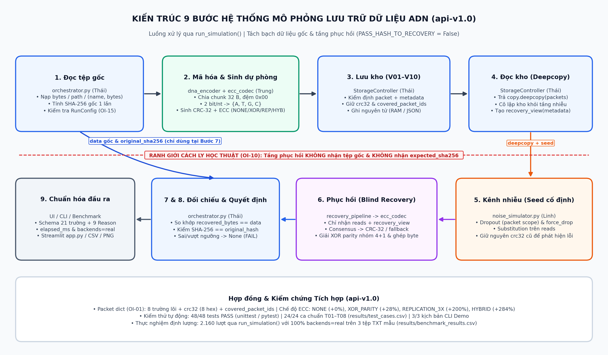
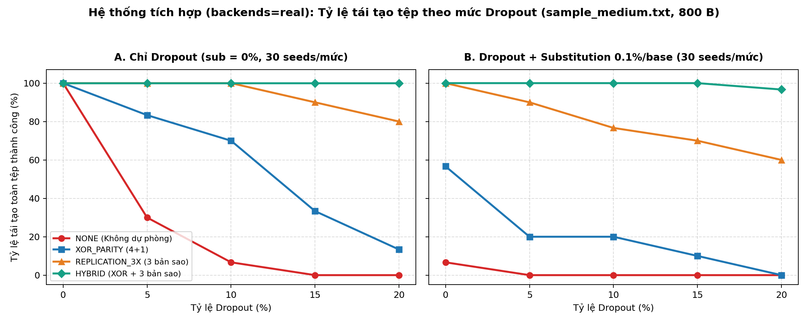
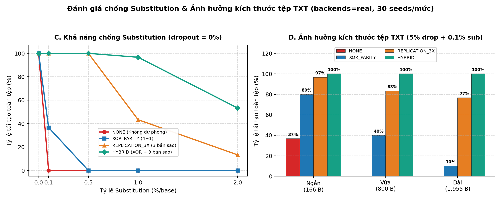

# Hệ thống Mô phỏng Kiến trúc Lưu trữ Dữ liệu bằng Phân tử ADN (`dna-storage`)

> **Tài liệu kỹ thuật & Báo cáo kiến trúc hệ thống (`api-v1.0`)**
> Phiên bản tích hợp hoàn chỉnh **Thái (Kiến trúc, Kho lưu trữ & Điều phối) + Trung (Mã hóa/Giải mã ADN & ECC) + Linh (Kênh nhiễu, Pipeline phục hồi & Thực nghiệm)**, sẵn sàng nối giao diện web Streamlit (`app.py` — **Dũng**) và mở rộng ngay lên các cơ chế mã hóa/nhiễu bậc cao.
>
> - **Kiểm thử tự động:** `48/48` test PASS (`unittest` & `pytest`, `24/24` kịch bản chuẩn T01–T08 PASS).
> - **Thực nghiệm định lượng (`backends = real`):** `2.160` lượt mô phỏng khép kín qua `run_simulation()`.
> - **Kho mã nguồn:** https://github.com/299quanglinh/ADN_Stogare (nhánh `main`, tag đóng băng `api-v1.0`).

---

## Mục lục

1. [Bản chất bài toán & Câu hỏi nghiên cứu](#1-bản-chất-bài-toán--câu-hỏi-nghiên-cứu)
2. [Kiến trúc 9 bước & Luồng chạy chi tiết (Trace qua `sample_medium.txt`)](#2-kiến-trúc-9-bước--luồng-chạy-chi-tiết-trace-qua-sample_mediumtxt)
3. [Sơ đồ gọi hàm giữa các Script (Call Graph)](#3-sơ-đồ-gọi-hàm-giữa-các-script-call-graph)
4. [Giải thích chi tiết từng Script `.py` (Mục đích, Cơ chế & Giá trị)](#4-giải-thích-chi-tiết-từng-script-py-mục-đích-cơ-chế--giá-trị)
5. [Cấu trúc thư mục `dna-storage/` & Vai trò từng thành phần](#5-cấu-trúc-thư-mục-dna-storage--vai-trò-từng-thành-phần)
6. [Đặc tả chi tiết Tham số, Hợp đồng dữ liệu & Schema kết quả](#6-đặc-tả-chi-tiết-tham-số-hợp-đồng-dữ-liệu--schema-kết-quả)
7. [7 Sai lệch kiến trúc đã xử lý triệt để khi hợp nhất hệ thống](#7-7-sai-lệch-kiến-trúc-đã-xử-lý-triệt-để-khi-hợp-nhất-hệ-thống)
8. [Phân tích kết quả thực nghiệm (2.160 lượt chạy `backends = real`)](#8-phân-tích-kết-quả-thực-nghiệm-2160-lượt-chạy-backends--real)
9. [Hướng dẫn chạy hệ thống & Tích hợp giao diện Streamlit (`app.py`)](#9-hướng-dẫn-chạy-hệ-thống--tích-hợp-giao-diện-streamlit-apppy)
10. [Các hướng mở rộng hệ thống (Sẵn sàng triển khai ngay)](#10-các-hướng-mở-rộng-hệ-thống-sẵn-sàng-triển-khai-ngay)

---

## 1. Bản chất bài toán & Câu hỏi nghiên cứu

### 1.1. Bối cảnh và bài toán cốt lõi
Trong lưu trữ dữ liệu lạnh dài hạn (*cold data*), phân tử ADN tổng hợp được nghiên cứu như một môi trường lưu trữ mật độ siêu cao nhờ khả năng biểu diễn thông tin qua 4 nucleotide `{A, T, G, C}`. Tuy nhiên, thách thức kỹ thuật cốt lõi không nằm ở phép đổi nhị phân sang 4 chữ cái, mà nằm ở việc toàn bộ chu trình **tổng hợp ADN → bảo quản → khuếch đại PCR → giải trình tự (sequencing)** luôn phát sinh hai cơ chế sai lệch đặc trưng:
1. **Mất đoạn phân tử (*Dropout*):** Một hoặc nhiều packet/oligo biến mất hoàn toàn trong quá trình xử lý hoặc không xuất hiện ở tập bản đọc (*reads*).
2. **Thay thế nucleotide (*Substitution*):** Một số vị trí base trong chuỗi đọc bị biến đổi nhầm sang một trong 3 nucleotide còn lại, làm sai lệch nội dung byte khi giải mã.

### 1.2. Câu hỏi nghiên cứu & các trục đánh đổi
Hệ thống được xây dựng để trả lời định lượng câu hỏi:
> **"Trong một mô hình lưu trữ ADN số, việc bổ sung dữ liệu dự phòng (ECC) làm thay đổi khả năng tái tạo chính xác 100% tệp gốc như thế nào khi xảy ra lỗi mất đoạn (dropout) hoặc thay thế nucleotide (substitution)?"**

Mỗi thí nghiệm định lượng đánh giá đồng thời sự đánh đổi (*trade-off*) trên 3 đại lượng:
- **Tỷ lệ tái tạo toàn tệp (*Whole-file Recovery Rate*):** Chỉ tính là thành công (`success = True`) khi dữ liệu đầu ra trùng khớp **100% từng byte và mã băm SHA-256** với tệp ban đầu.
- **Chi phí dư thừa lưu trữ (*Storage Overhead %*):** Tỷ lệ nucleotide lưu kho tăng thêm so với mã hóa thô (`len(data) * 4` nucleotide).
- **Thời gian thực thi (*elapsed_ms*):** Tổng thời gian xử lý toàn bộ chu trình từ nạp tệp đến xác minh toàn vẹn cuối.

### 1.3. Nguyên tắc cách ly học thuật (Chống gian lận mô phỏng)
Kiến trúc tách bạch tuyệt đối dữ liệu gốc khỏi tầng phục hồi thông qua 3 ranh giới cứng:
1. `PASS_HASH_TO_RECOVERY = False`: Tầng phục hồi chỉ nhận `reads` sau nhiễu và bản `recovery_view(metadata)` đã xóa `expected_sha256`; tuyệt đối không thấy tệp gốc hay mã hash gốc.
2. Kho lưu trữ chỉ cấp bản sao sâu (`copy.deepcopy`) để tầng nhiễu không thể làm biến đổi dữ liệu gốc trong kho.
3. Kênh nhiễu giữ nguyên mã `crc32` cũ trên mỗi read sau khi gây substitution, buộc tầng phục hồi phải tự phát hiện sai lệch bằng biểu quyết đa số (*consensus*) và kiểm tra CRC-32.

### 1.4. Vai trò và cơ chế của SHA-256 trong kiểm chứng toàn vẹn
**SHA-256** (*Secure Hash Algorithm 256-bit*) là hàm băm mật mã học một chiều (`hashlib.sha256`), ánh xạ một dãy byte đầu vào có kích thước bất kỳ thành một chuỗi "vân tay số" cố định dài **256 bit (`32 bytes` = `64` ký tự hex chữ thường)**. Trong hệ thống, SHA-256 giữ vai trò **"chốt chặn kiểm chứng cuối cùng"** với 3 đặc tính cốt lõi:

- **Tính xác định (*Deterministic*):** Cùng một tệp gốc luôn sinh ra duy nhất một mã SHA-256 (ví dụ `sample_medium.txt` 800 B luôn có mã `932aa3de6f5b1feb058db17623a2958fb161f73e664ba50875a96a19945731dc`, ghi nhận trong [experiment_conditions.json](./results/experiment_conditions.json)).
- **Hiệu ứng tuyết lở (*Avalanche Effect*):** Chỉ cần sai lệch đúng **1 bit** (tương ứng đổi nhầm 1/2 nucleotide, ví dụ `A` `00` → `T` `01`) ở bất kỳ chunk nào trong toàn tệp, mã SHA-256 đầu ra thay đổi hoàn toàn, giúp phát hiện tức thì cả các lỗi ghép sai thứ tự packet hoặc cắt sai phần đệm `0x00` ở chunk cuối.
- **Kháng va chạm (*Collision Resistance*):** Không gian $2^{256}$ giá trị khiến xác suất hai tệp khác nhau trùng mã băm là vô cùng nhỏ, đồng thời tính chất một chiều không cho phép suy ngược nội dung tệp từ chuỗi hash.

#### Phân biệt vai trò giữa `CRC-32` (cấp Packet) và `SHA-256` (cấp Toàn tệp)

| Tiêu chí | `CRC-32` (`crc32`) | `SHA-256` (`expected_sha256`) |
| :--- | :--- | :--- |
| **Kích thước** | `32 bit` (`8` ký tự hex) | `256 bit` (`64` ký tự hex) |
| **Phạm vi tính** | Từng khối `32 B` đã đệm | Toàn bộ mảng `bytes` tệp gốc |
| **Tầng sử dụng** | Tầng phục hồi (`dna_encoder` → `ecc_codec`) | Tầng kiểm định bên ngoài (`orchestrator`) |
| **Mục đích** | Phát hiện nhanh packet bị *substitution*, cứu hòa phiếu 1–1 (*CRC-32 fallback*) và đánh dấu *erasure* cho XOR Parity | Xác nhận tệp sau ghép trùng **100% từng bit** với bản gốc; quyết định `sha256_match = True/False` |
| **Quyền truy cập ở tầng phục hồi** | **Được truyền vào** (giữ nguyên mã cũ qua kênh nhiễu) | **Bị ẩn hoàn toàn** qua `recovery_view(metadata)` (`OI-10`) |

#### Vòng đời của SHA-256 qua các module `.py`
1. **Khởi tạo tại Bước 1 ([orchestrator.py](./dnastore/orchestrator.py)):** Hàm `sha256_hex(data)` tính `original_hash` ngay khi nạp tệp gốc.
2. **Kiểm tra chéo tại Bước 2 ([dna_encoder.py](./dnastore/dna_encoder.py)):** `encode_file()` tính `expected_sha256 = compute_sha256(raw_bytes)` gắn vào `metadata`; `orchestrator` đối chiếu `md["expected_sha256"] == original_hash` để bảo đảm encoder không nhận nhầm dữ liệu (`FAIL_ENCODER_ERROR` nếu lệch).
3. **Cô lập trước Bước 6 ([metadata_manager.py](./dnastore/metadata_manager.py)):** Khi gọi tầng phục hồi, `orchestrator` đặt `PASS_HASH_TO_RECOVERY = False` và truyền `recovery_view(stored_md)` (đã xóa khóa `expected_sha256`). Nhờ vậy bộ giải mã không thể dùng hash gốc làm công cụ dò đoán tổ hợp reads đúng (*oracle/brute-force*). Nếu gọi `ecc_codec.decode_or_recover()` độc lập ngoài `orchestrator` với metadata có sẵn `expected_sha256`, hàm tự gọi `verify_sha256()` trong [dna_decoder.py](./dnastore/dna_decoder.py).
4. **Phán quyết cuối tại Bước 7–8 ([orchestrator.py](./dnastore/orchestrator.py)):** Chỉ khi thỏa mãn đồng thời `out == data` và `sha256_hex(out) == original_hash`, hệ thống mới trả `success = True`, `sha256_match = True` và xuất `recovered_bytes`; nếu sai dù chỉ 1 bit (ví dụ chạy bản `mocks.py` không có CRC-32 để lọt lỗi substitution), hệ thống trả `FAIL_HASH_MISMATCH`, `recovered_bytes = None`.

---

## 2. Kiến trúc 9 bước & Luồng chạy chi tiết (Trace qua `sample_medium.txt`)



Để hiểu rõ cơ chế vận hành từ đầu đến cuối, hãy theo dõi hành trình của tệp mẫu [sample_medium.txt](./data/samples/sample_medium.txt) (`800 bytes`) đi qua hàm lõi `run_simulation()` trong [dnastore/orchestrator.py](./dnastore/orchestrator.py):

### Bước 1 — Đọc tệp gốc & tính dấu vân tay SHA-256 (`orchestrator.py`)
- Hàm `_load_input()` đọc đầu vào (`bytes`, đường dẫn tệp, hoặc `(filename, bytes)`) thành mảng `800 bytes` thô.
- Tính mã băm SHA-256 gốc (`256 bit` = `64` ký tự hex) một lần duy nhất qua `original_hash = sha256_hex(data)` (xem chi tiết cơ chế SHA-256 ở [Mục 1.4](#14-vai-trò-và-cơ-chế-của-sha-256-trong-kiểm-chứng-toàn-vẹn)).
- Kiểm tra hợp lệ `seed` và `RunConfig.from_dict(config)`. Tệp gốc và `original_hash` được giữ tại `orchestrator`, không đi vào kho hay tầng phục hồi.

### Bước 2 — Chia khối, đệm, mã hóa 2 bit/nt & sinh dự phòng (`dna_encoder.py` + `ecc_codec.py`)
- **Chia khối & đệm `0x00`:** `800 bytes` được cắt theo `chunk_size = 32 bytes` thành `25` khối `DATA` (`packet_id` từ `0` đến `24`). Nếu tệp không chia hết cho `32` (ví dụ `sample_short.txt` `166 bytes` → khối cuối `6 bytes`), bộ mã hóa đệm thêm `26` byte `0x00` ở khối cuối, ghi `payload_len = 6` và `file_size = 166` để tầng giải mã cắt đúng phần đệm.
- **Ánh xạ 2 bit/nucleotide:** Mỗi byte `8 bit` tách thành 4 cặp `2 bit` (MSB → LSB) theo quy ước cố định: `00 → A`, `01 → T`, `10 → G`, `11 → C` (ví dụ `0x1B = 00_01_10_11` → `"ATGC"`). Mỗi khối `32 B` trở thành chuỗi `128 nt` (mật độ `2,0 bit/nt`; từ chối tuyệt đối `'X'`, `'?'`).
- **Gắn mã kiểm tra `crc32`:** Tính CRC-32 (`8` ký tự hex) trên từng khối `32 B` đã đệm để nhận diện biến đổi base ở mức từng gói tin.
- **Sinh dự phòng trước khi lưu kho (`add_redundancy`):**
  - `NONE`: Giữ nguyên `25` gói `DATA` (`+0%` overhead).
  - `XOR_PARITY`: Gom mỗi `group_size = 4` gói `DATA` thành 1 nhóm và tính 1 gói `PARITY` bằng phép XOR từng byte trên trường $GF(2)$:
    $$P = D_0 \oplus D_1 \oplus D_2 \oplus D_3$$
    Với `25` gói `DATA` (`6` nhóm đủ 4 gói + `1` nhóm cuối gồm 1 gói) → sinh thêm `7` gói `PARITY` (`packet_id = 25..31`), tổng `32` gói lưu kho (`+28%` overhead).
  - `REPLICATION_3X`: Nhân bản mỗi gói `DATA` thành 3 bản sao (`copy_id = 0, 1, 2`) → tổng `75` gói lưu kho (`+200%` overhead).
  - `HYBRID`: Sinh `7` gói `PARITY` trước (`32` gói logic), rồi nhân bản cả `DATA` và `PARITY` lên 3 bản sao → tổng `96` gói lưu kho (`+284%` overhead).

### Bước 3 — Lưu vào kho ADN giả lập (`storage_controller.py`)
- `StorageController.new_file_id()` cấp mã tuần tự (`F01`, `F02`, ...) đã kiểm tra regex chống path traversal.
- `store_packets()` kiểm định metadata (`validate_metadata`) và từng packet (`DNAPacket.validate()`, `validate_packet_extra_fields()`, kiểm tra trùng khóa `(kind, packet_id, copy_id)`).
- Lưu vào bộ nhớ trong RAM (`root=None`, dùng cho benchmark tốc độ cao) hoặc ghi nguyên tử ra đĩa (`packets.json` + `metadata.json` via file tạm + `os.replace`). Kho bảo toàn `crc32` và `covered_packet_ids`, **không lưu bytes tệp gốc**.

### Bước 4 — Đọc bản sao sâu từ kho (`storage_controller.py` + `metadata_manager.py`)
- `read_packets(file_id)` và `read_metadata(file_id)` trả về `copy.deepcopy(...)`, cô lập hoàn toàn dữ liệu đã lưu trong kho khỏi mọi thao tác đột biến ở tầng nhiễu phía sau.

### Bước 5 — Mô phỏng kênh nhiễu (`noise_simulator.py`)
- Khởi tạo `random.Random(seed)` cục bộ (tái lập 100%, không đụng RNG toàn cục của Python).
- **Dropout:** Với `dropout_scope="packet"` (mặc định), mỗi bản sao lưu kho (`copy_id`) bị xóa hoàn toàn với xác suất `dropout_rate` (hoặc bị ép xóa theo `force_drop`). Gói mất biến mất hoàn toàn khỏi danh sách reads (không dùng `'?'`).
- **Substitution:** Mỗi gói sống sót sinh ra `read_count` bản đọc (`read_id = 0 .. read_count-1`). Mỗi vị trí trong `128 nt` đổi đều sang 1 trong 3 base còn lại với xác suất `substitution_rate`. Độ dài giữ nguyên `128 nt` và **mã `crc32` cũ được giữ nguyên**.

### Bước 6 — Pipeline phục hồi mù (`recovery_pipeline.py` → `ecc_codec.py`)
- `orchestrator` tạo `recovery_view(stored_md)` để **xóa bỏ `expected_sha256`** trước khi gọi `decode_or_recover(reads, md_for_recovery)`.
- Tầng phục hồi chạy tuần tự 5 công đoạn:
  1. **Lọc & gom nhóm:** Loại read sai `file_id`, gom toàn bộ reads theo `packet_id`.
  2. **Biểu quyết đa số (`majority_vote_consensus`):** So sánh từng cột `0..127` giữa các reads cùng `packet_id`, chọn ký tự có tần suất cao nhất. Nếu chỉ còn 2 reads và bị hòa phiếu tại ít nhất 1 vị trí → trả `None` để chuyển sang CRC-32 fallback.
  3. **Kiểm tra CRC-32 & CRC-32 Fallback:** Giải mã chuỗi consensus sang `32 bytes` và đối chiếu `compute_crc32()` với `expected_crc`. Nếu bị hòa phiếu 1–1 hoặc đồng thuận sai CRC, hệ thống duyệt từng bản đọc đơn lẻ xem có bản nào khớp `expected_crc` cũ để cứu; nếu không còn bản nào khớp → đánh dấu packet đó là **erasure** (`None`).
  4. **Khôi phục XOR Parity theo nhóm:** Trong mỗi nhóm `group_size = 4` `DATA` + `1` `PARITY`, nếu có đúng `1` khối `DATA` bị erasure và `PARITY` còn hợp lệ, hệ thống tái tạo khối mất nhờ tính chất $X \oplus X = 0$ (ví dụ mất $D_1 \Rightarrow D_1 = P \oplus D_0 \oplus D_2 \oplus D_3$). Nếu cùng một nhóm mất $\ge 2$ khối (kể cả `1 DATA + 1 PARITY`), hệ phương trình vô định → ném `RecoveryFailure` (`FAIL_UNRECOVERABLE`).
  5. **Ghép khối & cắt đệm:** Nối lần lượt các khối `0..total_packets-1`, cắt độ dài khối cuối bằng `file_size % chunk_size` (nếu chia hết lấy trọn `chunk_size`) và trả `bytes` về `orchestrator`.

### Bước 7 & 8 — Đối chiếu cuối cùng & Quyết định trạng thái (`orchestrator.py`)
- So sánh trực tiếp `out == data` **và** `sha256_hex(out) == original_hash`.
- Chỉ gán `success = True`, `recovered_bytes = out`, `sha256_match = True` khi khớp cả hai; gắn `OK_CLEAN` (nếu `n_packets_lost == 0` và `n_substituted_bases == 0`) hoặc `OK_RECOVERED` (nếu có lỗi và đã sửa xong).
- Mọi trường hợp trả về sai byte hoặc ném `RecoveryFailure` đều trả `success = False`, `recovered_bytes = None`, `sha256_match = False`.

### Bước 9 — Chuẩn hóa đầu ra (`orchestrator.py`)
- Trong khối `finally`, tính chính xác `elapsed_ms = (time.perf_counter() - t0) * 1000.0` (kể cả khi lỗi) và trả về `dict` chuẩn 21 trường kèm nhãn `backends` (`real` hoặc `mock`).

---

## 3. Sơ đồ gọi hàm giữa các Script (Call Graph)

Biểu đồ dưới đây thể hiện chính xác cách các file `.py` gọi nhau trong quá trình thực thi:

```text
  [Điểm gọi vào / Entrypoints]
   ├── dnastore/cli.py (main -> demo / run)
   ├── benchmark.py (run_benchmark -> generate_charts)
   ├── tests/*.py (unittest / pytest)
   └── app.py (Streamlit UI — Dũng)
            │
            ▼  gọi run_simulation(file, config, seed)
  [dnastore/orchestrator.py] ◄── imports errors.py, models.py, metadata_manager.py
     │
     ├──► dnastore/backends.py :: load_backends()
     │       ├── (mặc định real):
     │       │     ├── encode_file        -> dnastore/dna_encoder.py
     │       │     ├── apply_noise        -> dnastore/noise_simulator.py
     │       │     └── decode_or_recover  -> dnastore/recovery_pipeline.py
     │       └── (khi DNASTORE_USE_MOCK=1): dnastore/mocks.py
     │
     ├──► 1) encode_file() [dna_encoder.py]
     │          └──► (nếu ecc_mode != "NONE") add_redundancy() [ecc_codec.py]
     │                                             └──► xor_bytes_list(), dna_to_bytes(), bytes_to_dna()
     │
     ├──► 2) StorageController [storage_controller.py]
     │          ├── new_file_id()
     │          ├── store_packets() -> DNAPacket.validate() [models.py], save_metadata() [metadata_manager.py]
     │          ├── read_packets() / read_metadata() -> trả copy.deepcopy()
     │          └── recovery_view(stored_md) [metadata_manager.py] -> xóa expected_sha256
     │
     ├──► 3) apply_noise(stored, cfg.noise_config(), seed) [noise_simulator.py]
     │          └──► dùng random.Random(seed) cục bộ -> trả (reads, stats)
     │
     └──► 4) decode_or_recover(reads, md_for_recovery) [recovery_pipeline.py]
                └──► ecc_codec.decode_or_recover(reads, metadata) [ecc_codec.py]
                        ├── majority_vote_consensus()
                        ├── dna_to_bytes() [dna_decoder.py]
                        ├── compute_crc32() [dna_encoder.py] (CRC-32 fallback)
                        ├── xor_bytes_list() (tái tạo erasure nhóm 4+1)
                        └── (chỉ chạy nếu expected_sha256 không bị ẩn): verify_sha256() [dna_decoder.py]
```

---

## 4. Giải thích chi tiết từng Script `.py` (Mục đích, Cơ chế & Giá trị)

### 4.1. Gói mã nguồn lõi `dnastore/` (14 tệp — 100% thư viện chuẩn Python 3.10+)

#### 1. [dnastore/\_\_init\_\_.py](./dnastore/__init__.py) *(44 dòng)*
- **Mục đích:** Cổng export API công khai của gói `dnastore`.
- **Thành phần chính:** Re-export trong `__all__` toàn bộ 28 ký hiệu dùng chung (`run_simulation`, `StorageController`, `encode_file`, `decode_file`, `apply_noise`, `decode_or_recover`, `decode_or_recover_report`, `DNAPacket`, `RunConfig`, `Reason`, các lớp lỗi, hàm tiện ích hash/CRC/GC).
- **Giá trị:** Giúp UI (`app.py`), `benchmark.py` và các bài test import thống nhất (`from dnastore import run_simulation`) mà không bị phụ thuộc vào cấu trúc file nội bộ.

#### 2. [dnastore/errors.py](./dnastore/errors.py) *(33 dòng)*
- **Mục đích:** Chuẩn hóa phân cấp ngoại lệ nội bộ gắn thẳng với mã trạng thái `Reason`.
- **Các lớp định nghĩa:**
  - `DNAStoreError(code="FAIL_INTERNAL_ERROR")`: Lớp cha lưu thuộc tính `.code`.
  - `ValidationError(code="FAIL_INVALID_INPUT")`: Sai kiểu/giá trị đầu vào (file rỗng, `config`, `packet`, `metadata`).
  - `FileNotInStore(code="FAIL_STORAGE_ERROR")` & `FileAlreadyInStore(code="FAIL_STORAGE_ERROR")`: Lỗi truy xuất hoặc ghi đè kho.
  - `RecoveryFailure(code="FAIL_UNRECOVERABLE")`: Tầng phục hồi báo vượt ngưỡng sửa lỗi (hoặc `FAIL_HASH_MISMATCH` khi chạy độc lập).
- **Giá trị:** Cho phép `orchestrator` bắt lỗi theo đúng ngữ nghĩa từng tầng và quy đổi thành `result["reason"]` thay vì làm văng traceback ra UI.

#### 3. [dnastore/models.py](./dnastore/models.py) *(207 dòng)*
- **Mục đích:** "Nguồn sự thật duy nhất" (*Single Source of Truth*) cho hợp đồng dữ liệu và schema đầu ra.
- **Thành phần chính:**
  - Hằng quy ước: `ALPHABET = "ATGC"`, `KINDS = ("DATA", "PARITY")`, `SUPPORTED_ECC_MODES`, `PACKET_FIELDS` (8 trường lõi), `METADATA_REQUIRED` (7 trường), `RESULT_CORE_FIELDS` (10 trường), `RESULT_EXTENSION_FIELDS` (11 trường).
  - `Reason`: Chứa 9 mã trạng thái chuẩn (`OK_CLEAN` .. `FAIL_INTERNAL_ERROR`).
  - `DNAPacket`: Dataclass bất biến (`@dataclass(frozen=True)`) với `from_dict()`, `to_dict()`, `validate()` kiểm tra chặt `file_id`, `packet_id`, `total_packets`, `kind`, ký tự `A/T/G/C`, và `payload_len * 4 <= len(dna_sequence)`.
  - `validate_packet_extra_fields(d)`: Kiểm định `crc32` (đúng 8 hex) và `covered_packet_ids` (`list[int >= 0]`).
  - `RunConfig`: Kiểm tra chặt đúng 8 khóa cấu hình hợp lệ (`chunk_size`, `ecc_mode`, `group_size`, `copies`, `dropout_rate`, `substitution_rate`, `read_count`, `force_drop`), chặn khóa lạ (typo), và chuyển đổi sang `ecc_params()` / `noise_config()`.
  - `check_result_schema(result)`: Hàm kiểm định cấu trúc và bất biến của dict kết quả (`success=True` ⇔ `recovered_bytes is not None`).
- **Giá trị:** Phát hiện ngay sai lệch kiểu dữ liệu tại biên giữa các module, chống lỗi ngầm khi mở rộng hoặc ghép UI.

#### 4. [dnastore/metadata_manager.py](./dnastore/metadata_manager.py) *(79 dòng)*
- **Mục đích:** Quản lý vòng đời metadata, ghi tệp an toàn và tạo góc nhìn phục hồi cô lập.
- **Các hàm chính:**
  - `sha256_hex(data)`: Trả mã băm SHA-256 dạng 64 ký tự hex chữ thường.
  - `validate_metadata(md)`: Kiểm tra đủ 7 trường `METADATA_REQUIRED`, xác nhận `file_size`/`chunk_size`/`total_packets >= 1`, định dạng `expected_sha256` (`^[0-9a-f]{64}$`), trả về `copy.deepcopy(md)` (giữ nguyên các trường mở rộng như `ecc_params`, `group_size`).
  - `recovery_view(md)`: Tạo `deepcopy(md)` và gọi `view.pop("expected_sha256", None)`.
  - `save_metadata(path, md)` & `load_metadata(path)`: Ghi nguyên tử qua `tempfile.mkstemp` + `os.replace` (tránh tệp dở khi crash giữa chừng) và nạp lại qua `validate_metadata`.
- **Giá trị:** Bảo đảm metadata luôn nhất quán và hiện thực hóa ranh giới bảo mật học thuật OI-10 ở mức dữ liệu.

#### 5. [dnastore/storage_controller.py](./dnastore/storage_controller.py) *(188 dòng)*
- **Mục đích:** Mô phỏng kho lưu trữ gói ADN theo `file_id`, hỗ trợ song song RAM và đĩa cứng JSON.
- **Cơ chế & hàm chính:**
  - `__init__(root=None)`: Nếu `root=None` lưu hoàn toàn trong `_mem` (RAM); nếu truyền đường dẫn tạo thư mục lưu theo cấu trúc `<root>/<file_id>/{packets.json, metadata.json}`. Dùng `threading.RLock()` bảo vệ truy cập đồng thời.
  - `new_file_id()`: Quét cả RAM, `_reserved` và đĩa để cấp mã tuần tự `F01`, `F02`, ... không trùng lặp.
  - `store_packets(file_id, packets, metadata, overwrite=False)`: Thực thi toàn bộ quy tắc kiểm định V01–V10 (`_check_id` chống path traversal theo regex `^[A-Za-z0-9_-]{1,64}$`, kiểm tra metadata khớp `file_id`, `total_packets`, `packet_id < total_packets` cho `DATA`, chống trùng `(kind, packet_id, copy_id)`). Tạo bản sao sâu giữ nguyên `crc32` và `covered_packet_ids`, ghi nguyên tử `_atomic_write_json()`, trả về tóm tắt `_summary()` (`n_packets`, `n_data`, `n_parity`, `n_nucleotides`).
  - `read_packets(file_id, kind=None)` & `read_metadata(file_id)`: Luôn trả `copy.deepcopy(...)` để ngăn tầng ngoài sửa dữ liệu kho.
  - `exists()`, `list_files()`, `storage_stats()`, `delete_file()`: Đủ nghiệp vụ quản trị kho cho cả CLI/UI/benchmark.
- **Giá trị:** Đóng vai trò lớp lưu trữ đáng tin cậy: nhanh trong benchmark RAM (`OI-18`), bền vững trên đĩa khi cần kiểm tra JSON, và bất biến trước nhiễu.

#### 6. [dnastore/backends.py](./dnastore/backends.py) *(46 dòng)*
- **Mục đích:** Bộ nạp động (*Dependency Injection Loader*) cho 3 hàm xử lý lõi.
- **Cơ chế:** Định nghĩa `IMPORT_PATHS` trỏ tới 3 module thật (`dnastore.dna_encoder:encode_file`, `dnastore.noise_simulator:apply_noise`, `dnastore.recovery_pipeline:decode_or_recover`). Hàm `load_backends(use_mock=None)` kiểm tra cờ hoặc biến môi trường `DNASTORE_USE_MOCK=1`; nếu không mock sẽ nạp module thật bằng `importlib` và gắn nhãn `"real"` vào `Backends.sources`.
- **Giá trị:** Tách rời điều phối khỏi cài đặt cụ thể, giúp chạy kiểm thử đối chiếu `real` vs `mock` và minh bạch nguồn chạy trong mọi file CSV/JSON kết quả.

#### 7. [dnastore/mocks.py](./dnastore/mocks.py) *(150 dòng)*
- **Mục đích:** Bản cài đặt giả lập tối giản dùng kiểm chứng kiến trúc `orchestrator` và chạy thử hồi quy.
- **Đặc điểm:** Chỉ hỗ trợ `NONE` và `XOR_PARITY`, không gắn `crc32`, không bảo vệ substitution. Trong `test_orchestrator.py`, bản mock cố tình bộc lộ trường hợp substitution lọt qua tầng giải mã nhưng bị `orchestrator` bắt lại thành `FAIL_HASH_MISMATCH` thay vì báo thành công giả.
- **Giá trị:** Chứng minh `orchestrator` tự xác minh độc lập và làm mốc đối chiếu giá trị của `crc32` + `REPLICATION_3X` + `HYBRID` ở bản thật.

#### 8. [dnastore/dna_encoder.py](./dnastore/dna_encoder.py) *(155 dòng)*
- **Mục đích:** Mã hóa nhị phân sang chuỗi ADN, cắt khối, đệm, tính checksum và gọi sinh dự phòng.
- **Hàm & hằng chính:**
  - `BITS_TO_BASE` và `BYTE_TO_DNA`: Bảng tra dựng sẵn cho toàn bộ `256` giá trị byte (`0..255`), giúp `bytes_to_dna()` chạy cực nhanh bằng nối chuỗi $\mathcal{O}(n)$.
  - `compute_sha256(data)`, `compute_crc32(data)` (`zlib.crc32` định dạng `08x`), `compute_gc_content(dna_sequence)` (tính `% (G + C)` phục vụ quan sát sinh học).
  - `encode_file(data, file_id, chunk_size=32, filename="unknown.bin", ecc_mode="NONE", group_size=4, replication_factor=1, ecc_params=None)`: Chuẩn hóa `REPLICATION` → `REPLICATION_3X`, cắt chunk và đệm `0x00`, gán `group_id = idx // group_size`, tính `crc32` cho từng chunk đệm, gọi `ecc_codec.add_redundancy()` nếu `ecc_mode != "NONE"`, và xuất `(packets, metadata)` đầy đủ trường mở rộng.
- **Giá trị:** Đảm bảo mã hóa song ánh chính xác tuyệt đối 2 bit/nt, hỗ trợ mọi định dạng byte nhị phân (TXT UTF-8, PNG, PDF).

#### 9. [dnastore/dna_decoder.py](./dnastore/dna_decoder.py) *(94 dòng)*
- **Mục đích:** Giải mã ngược chuỗi ADN về `bytes` và đối chiếu SHA-256.
- **Hàm chính:**
  - `dna_to_bytes(dna_sequence)`: Kiểm tra kiểu `str`, độ dài chia hết cho 4, từ chối mọi ký tự ngoài `VALID_BASES = {"A", "T", "G", "C"}`, ghép 4 nucleotide (4 cặp 2 bit) về 1 byte.
  - `verify_sha256(data, expected_sha256)`: Đối chiếu hash ở bước cuối.
  - `decode_file(packets, metadata)`: Giải mã thẳng các gói `DATA` (không qua sửa lỗi ECC), kiểm tra thiếu gói, kiểm tra độ dài chuỗi `chunk_size * 4`, cắt đệm theo `payload_len`, đối chiếu `file_size` và `expected_sha256`.
- **Giá trị:** Cung cấp bộ giải mã chặt chẽ không chấp nhận ký tự lỗi `'X'`/`'?'`, dùng cho cả tầng ECC lẫn kiểm thử round-trip trực tiếp.

#### 10. [dnastore/ecc_codec.py](./dnastore/ecc_codec.py) *(440 dòng)*
- **Mục đích:** Cài đặt 4 cơ chế dự phòng và thuật toán khôi phục đa tầng.
- **Các hàm lõi:**
  - `xor_bytes_list(chunks)`: Phép XOR từng byte trên danh sách các chunk cùng độ dài.
  - `add_redundancy(base_packets, chunk_size, ecc_mode="XOR_PARITY", group_size=4, replication_factor=3)`: Sinh gói `PARITY` cho từng `group_id` (kèm `crc32` và `covered_packet_ids`) nếu là `XOR_PARITY`/`HYBRID`; nhân bản các gói logic thành `rep` bản sao (`copy_id = 0 .. rep-1`, ép tối thiểu `3` bản khi `replication_factor <= 1`) nếu là `REPLICATION_3X`/`HYBRID`.
  - `majority_vote_consensus(reads, expected_len)`: Lọc read hợp lệ (đúng độ dài & chỉ gồm `A/T/G/C`), trả trực tiếp nếu có 1 read, hoặc biểu quyết theo từng cột base; phát hiện tình huống 2 reads hòa phiếu (`len(valid_reads) == 2` và `ties > 0`) để kích hoạt fallback.
  - `decode_or_recover(reads, metadata)`: Chạy `_validate_and_recover` → `_decode_or_recover_core`:
    1. Kiểm tra metadata (`file_size`, `chunk_size`, `total_packets == ceil(file_size / chunk_size)`, `ecc_mode`, `group_size`), lọc read theo `file_id`.
    2. Với từng `packet_id` (`DATA` và `PARITY` nếu `has_parity`), chạy `process_packet_id()`: majority vote → giải mã `dna_to_bytes()` → kiểm tra `expected_crc` (chọn CRC xuất hiện phổ biến nhất từ các reads); nếu hòa phiếu hoặc sai CRC thì gọi `crc_fallback()` thử từng read thô để cứu gói. Nếu thất bại hết → đánh dấu `None` (erasure) và ghi `erasure_reasons[pid]`.
    3. Quét từng nhóm `gid`: nếu mất đúng `1` khối `DATA` và `PARITY` còn sống (`has_parity=True`), khôi phục bằng `xor_bytes_list(surviving_bytes)`; nếu mất $\ge 2$ khối hoặc không có parity → trả `success=False`, `error_type="UNRECOVERABLE"`.
    4. Ghép lại toàn bộ chunk, cắt khối cuối theo `file_size % chunk_size`. Nếu `expected_sha256` tồn tại (khi gọi độc lập), kiểm tra hash; nếu bị ẩn bởi `recovery_view()` (khi chạy qua `orchestrator`), trả ngay `recovered_bytes` để `orchestrator` tự xác minh cuối cùng.
- **Giá trị:** Kết hợp hiệu quả xử lý lỗi substitution (Consensus + CRC-32 fallback) với lỗi dropout (Replication + XOR Parity theo nhóm) trong một pipeline thống nhất.

#### 11. [dnastore/noise_simulator.py](./dnastore/noise_simulator.py) *(197 dòng)*
- **Mục đích:** Mô phỏng kênh nhiễu dropout và substitution có `seed` tái lập tuyệt đối.
- **Cơ chế chi tiết:**
  - `CONFIG_KEYS = {"dropout_rate", "substitution_rate", "read_count", "force_drop", "dropout_scope"}`: Kiểm định chặt giá trị hữu hạn trong `[0, 1]`, `read_count >= 1`, `seed` là `int`.
  - `_prepare(packets)`: Kiểm tra hợp lệ từng packet, kiểm tra trùng khóa `(file_id, kind, group_id, packet_id, copy_id)`, và `deepcopy` toàn bộ trước khi rút thăm.
  - `apply_noise(packets, config, seed)`:
    - Khởi tạo `rng = random.Random(seed)` độc lập hoàn toàn với module `random` toàn cục.
    - Hỗ trợ `force_drop` dạng `[["DATA", 1]]` (mất mọi bản sao của gói logic) hoặc `[["DATA", 1, 0]]` (mất đúng `copy_id = 0`).
    - Hỗ trợ `dropout_scope`: `"packet"` (mặc định, rút thăm dropout độc lập từng bản sao lưu kho) và `"logical"` (rút thăm theo `logical_key`, mất đồng loạt mọi bản sao).
    - Với từng packet sống sót, lặp `read_count` lần, tại mỗi nucleotide với xác suất `substitution_rate` đổi đều sang `ALTERNATIVES[base]` (3 base còn lại). Giữ nguyên `crc32` cũ và gán `read_id`.
    - Trả về `(reads, stats)` chứa cả khóa chuẩn của Thái (`n_packets_in`, `n_dropped_packets`, `n_substituted_bases`, `n_reads`) lẫn khóa chi tiết của Linh (`logical_packets_*`, `source_packets_*`, `bases_processed`, `observed_*`).
- **Giá trị:** Đảm bảo 100% tính lặp lại khoa học, hỗ trợ cả mô phỏng xác suất lẫn kịch bản ép lỗi xác định cho demo/test.

#### 12. [dnastore/recovery_pipeline.py](./dnastore/recovery_pipeline.py) *(71 dòng)*
- **Mục đích:** Lớp adapter kết nối chữ ký hàm giữa `orchestrator.py` và `ecc_codec.py`.
- **Hàm cung cấp:**
  - `decode_or_recover(reads, metadata) -> bytes`: Gọi `ecc_codec.decode_or_recover(reads, metadata)`. Nếu `success=True` trả `bytes`; nếu lỗi thì chuyển `error_type == "INVALID_METADATA"` → `ValidationError`, `"HASH_MISMATCH"` → `RecoveryFailure(code=Reason.FAIL_HASH_MISMATCH)`, các lỗi còn lại → `RecoveryFailure(code=Reason.FAIL_UNRECOVERABLE)`.
  - `decode_or_recover_report(reads, metadata, *, dropout_rate=0.0, substitution_rate=0.0, seed=0) -> dict`: Trả đầy đủ dict thống kê chi tiết của `ecc_codec` kèm tham số nhiễu phục vụ phân tích chuyên sâu.
- **Giá trị:** Giữ tách biệt lớp lõi thuật toán (trả dict giàu thông tin) và lớp tích hợp pipeline (trả `bytes` hoặc ném ngoại lệ chuẩn).

#### 13. [dnastore/orchestrator.py](./dnastore/orchestrator.py) *(196 dòng)*
- **Mục đích:** Điểm điều phối trung tâm `run_simulation()` nối trọn 9 bước thực thi.
- **Cơ chế đặc biệt:**
  - `_load_input()` hỗ trợ linh hoạt `bytes`, `str`/`Path`, hoặc `(filename, bytes)`.
  - `_call_encoder()` sử dụng `inspect.signature` để gọi tương thích cả mock lẫn `dna_encoder.encode_file` thật.
  - Kiểm tra `md["expected_sha256"] == original_hash` ngay sau bước encode để chặn lỗi encoder trước khi vào kho.
  - Bao bọc toàn bộ thân hàm trong `try ... except DNAStoreError ... except Exception ... finally`, cam kết **không bao giờ ném exception ra ngoài**, luôn trả đủ 21 trường theo schema và luôn cập nhật `elapsed_ms`.
- **Giá trị:** Giao diện duy nhất, an toàn tuyệt đối để Streamlit UI, CLI và benchmark gọi trực tiếp.

#### 14. [dnastore/cli.py](./dnastore/cli.py) *(90 dòng)*
- **Mục đích:** Công cụ dòng lệnh (CLI) cho phép trình diễn nhanh và chạy mô phỏng từng tệp từ terminal.
- **Hai lệnh con (`subparsers`):**
  - `python -m dnastore.cli demo [--mock]`: Chạy tuần tự 3 kịch bản chuẩn trên [sample_medium.txt](./data/samples/sample_medium.txt) (`XOR_PARITY`, `seed=42`): (1) Không lỗi → `OK_CLEAN`, (2) `force_drop=[["DATA", 1]]` → `OK_RECOVERED`, (3) `force_drop=[["DATA", 0], ["DATA", 1]]` → `FAIL_UNRECOVERABLE`.
  - `python -m dnastore.cli run <file> [--ecc ...] [--chunk-size 32] [--group-size 4] [--copies 1] [--dropout 0.0] [--subst 0.0] [--read-count 1] [--seed 0] [--mock]`: Chạy 1 lượt bất kỳ và in JSON kết quả (thay `recovered_bytes` bằng chuỗi tóm tắt `<N bytes>` để dễ đọc). Tự động cấu hình UTF-8 trên Windows (`sys.stdout.reconfigure(encoding="utf-8")`).
- **Giá trị:** Phục vụ kiểm thử nhanh qua terminal và làm phương án demo dự phòng ổn định.

---

### 4.2. Script thực nghiệm & Bộ kiểm thử tự động (`benchmark.py` và `tests/`)

#### [benchmark.py](./benchmark.py) *(326 dòng)*
- **Mục đích:** Chạy hàng loạt mô phỏng định lượng có kiểm soát, tổng hợp số liệu thống kê và vẽ biểu đồ báo cáo.
- **Cơ chế hoạt động:**
  - Ép sử dụng `load_backends(use_mock=False)` và assert 100% nguồn `"real"`.
  - Mỗi lượt gọi `run_simulation((filename, data), cfg, seed=seed, storage=StorageController(), backends=be)` với một kho RAM riêng biệt (độc lập tuyệt đối, tốc độ cao).
  - Thực thi `2.160` lượt (`--trials 30`, yêu cầu tối thiểu 30 seeds/mức) cho 4 kịch bản:
    - **A (`pure_dropout`):** `sample_medium.txt`, dropout `{0, 5, 10, 15, 20}%`, substitution `0%`, seeds `10000 + lvl*100 + t` → `600` lượt.
    - **B (`mixed_dropout_sub_01pct`):** `sample_medium.txt`, dropout `{0, 5, 10, 15, 20}%`, substitution `0.1%`, seeds `20000 + lvl*100 + t` → `600` lượt.
    - **C (`pure_substitution`):** `sample_medium.txt`, dropout `0%`, substitution `{0, 0.1, 0.5, 1.0, 2.0}%`, seeds `30000 + lvl*100 + t` → `600` lượt.
    - **D (`txt_size_scaling_5pct_01pct`):** 3 tệp (`sample_short.txt`, `sample_medium.txt`, `sample_long.txt`), dropout `5%`, substitution `0.1%`, seeds `40000 + t` → `360` lượt.
  - Ghi [results/benchmark_results.csv](./results/benchmark_results.csv), [results/benchmark_summary.csv](./results/benchmark_summary.csv), [results/experiment_conditions.json](./results/experiment_conditions.json) và gọi `generate_charts()` xuất 2 ảnh PNG `180 dpi`.

#### Bộ 5 file kiểm thử trong `tests/` (`48/48` PASS)
1. [tests/test_storage.py](./tests/test_storage.py) *(11 tests)*: Kiểm tra lưu/đọc RAM & JSON trên đĩa (mở lại `StorageController` mới từ thư mục), hồi quy bảo toàn `crc32` và `covered_packet_ids`, tính bất biến `deepcopy`, cấp `file_id` tuần tự, từ chối trùng ID trừ khi `overwrite=True`, chặn path traversal (`../x`), kiểm tra 8 mutation đầu vào sai (base `'X'`, `kind` sai, `crc32` sai...), thống kê/xóa kho và `recovery_view` ẩn hash.
2. [tests/test_orchestrator.py](./tests/test_orchestrator.py) *(19 tests)*: Chạy song song cả `mock` và `real` cho T01–T05, T07, T08, dữ liệu nhị phân `PNGLIKE`, mất 2 khối ở 2 nhóm khác nhau vẫn khôi phục được, kiểm chứng `check_result_schema()` trên mọi nhánh, kiểm chứng lỗi encoder/hash sai, dùng hàm spy chứng minh `decode_or_recover` không bao giờ nhận `expected_sha256`, dùng `evil_noise` chứng minh kho không bị hỏng, và xác minh bản thật dùng `crc32` cứu substitution trong khi mock trả `FAIL_HASH_MISMATCH`.
3. [tests/test_codec.py](./tests/test_codec.py) *(9 tests)*: Kiểm tra song ánh 2 bit/nt trên toàn bộ `bytes(range(256))`, từ chối `'X'`, `'?'`, độ dài lẻ và chữ số, round-trip TXT, hỗ trợ `ecc_params`, khôi phục XOR ở mọi vị trí kể cả chunk cuối, mất `DATA + PARITY` cùng nhóm thất bại, hòa phiếu 2 reads được CRC-32 fallback cứu, chạy với `recovery_view` không có `expected_sha256`, và kiểm tra chữ ký hàm chỉ nhận `['reads', 'metadata']`.
4. [tests/test_noise_simulator.py](./tests/test_noise_simulator.py) *(8 tests)*: Kiểm tra 0% lỗi giữ nguyên toàn bộ packet, lặp lại theo seed mà không làm thay đổi `random.getstate()`, không mutate các trường lồng nhau của packet gốc, `force_drop` xác định, `dropout_scope="packet"` vs `"logical"`, substitution 100% đổi mọi base nhưng giữ nguyên `crc32`, và từ chối 12 cấu hình bất hợp lệ.
5. [tests/test_recovery.py](./tests/test_recovery.py) *(1 test tích hợp chạy 24 kịch bản)*: Chạy trọn vẹn 8 ca tiêu chuẩn T01–T08 trên cả 3 tệp TXT mẫu qua `run_simulation()` với `backends=real` (xác minh tính lặp lại ở T08 với `seed=2026`); khi chạy trực tiếp bằng `python -m tests.test_recovery` sẽ xuất bảng log ra [results/test_cases.csv](./results/test_cases.csv).

---

## 5. Cấu trúc thư mục `dna-storage/` & Vai trò từng thành phần

Hiện tại trên đĩa và trên GitHub (`299quanglinh/ADN_Stogare`), toàn bộ dự án gồm `35` tệp được tổ chức gọn thành các phân vùng rõ ràng:

```text
dna-storage/
├── .gitignore                          # Loại trừ __pycache__/, *.py[cod], .pytest_cache/, data/store/, .venv/, venv/, *.tmp khỏi Git
├── README.md                           # Tài liệu báo cáo tổng quan, giải thích chi tiết script, thông số & hướng dẫn chạy
├── CONGVIECCANLAM.md                   # Danh sách kiểm tra các đầu việc tiếp theo (UI app.py, mẫu PNG/PDF, báo cáo cuối, demo)
├── requirements.txt                    # Danh sách phụ thuộc đã chốt OI-17 (matplotlib>=3.7, pytest>=7.4, streamlit>=1.32, pandas>=2.0)
├── benchmark.py                        # Script thực nghiệm 2.160 lượt và sinh CSV/JSON/PNG trong results/
│
├── dnastore/                           # Gói mã nguồn lõi (14 file .py, chạy thuần Python stdlib)
│   ├── __init__.py                     # Export Public API của toàn gói
│   ├── errors.py                       # Các lớp ngoại lệ gắn mã Reason
│   ├── models.py                       # DNAPacket, RunConfig, Reason, hằng quy ước và validator schema
│   ├── metadata_manager.py             # Kiểm định metadata, ghi/đọc nguyên tử và recovery_view ẩn hash
│   ├── storage_controller.py           # Kho lưu trữ giả lập RAM / JSON trên đĩa theo file_id
│   ├── backends.py                     # Nạp động 3 module real (hoặc mock qua DNASTORE_USE_MOCK=1)
│   ├── mocks.py                        # Bộ cài đặt giả lập đối chiếu kiểm thử
│   ├── dna_encoder.py                  # Mã hóa bytes -> A/T/G/C, chunking, padding 0x00, CRC-32, GC-content
│   ├── dna_decoder.py                  # Giải mã A/T/G/C -> bytes, từ chối ký tự lạ, đối chiếu SHA-256
│   ├── ecc_codec.py                    # 4 chế độ ECC, majority vote, CRC-32 fallback và giải XOR parity
│   ├── noise_simulator.py              # Kênh mô phỏng dropout & substitution có seed và force_drop
│   ├── recovery_pipeline.py            # Adapter chuẩn hóa ngoại lệ/bytes nối ecc_codec với orchestrator
│   ├── orchestrator.py                 # Điều phối trọn luồng 9 bước run_simulation()
│   └── cli.py                          # Giao diện dòng lệnh demo 3 kịch bản & chạy từng tệp
│
├── data/
│   ├── samples/                        # Dữ liệu mẫu đầu vào cố định dùng chung cho test & benchmark
│   │   ├── sample_short.txt            # 166 B (6 DATA chunks, 2 nhóm XOR) — khảo sát tệp ngắn có 26 byte padding
│   │   ├── sample_medium.txt           # 800 B (25 DATA chunks, tròn bội số 32 B, 7 nhóm XOR) — tệp chuẩn chính
│   │   └── sample_long.txt             # 1.955 B (62 DATA chunks, 16 nhóm XOR) — khảo sát tác động tăng kích thước
│   └── (store/)                        # Thư mục runtime tạo tự động khi lưu kho ra đĩa (đã chặn bởi .gitignore)
│
├── tests/                              # 5 bộ kiểm thử tự động (48/48 test PASS)
│   ├── test_storage.py                 # 11 test kho & metadata
│   ├── test_orchestrator.py            # 19 test điều phối mock/real & cách ly bảo mật
│   ├── test_codec.py                   # 9 test mã hóa, giải mã & ECC
│   ├── test_noise_simulator.py         # 8 test kênh nhiễu & tái lập seed
│   └── test_recovery.py                # 1 test tổng hợp chạy 24 ca T01–T08 và xuất test_cases.csv
│
├── results/                            # Kết quả thực nghiệm chính thức (100% backends = real)
│   ├── test_cases.csv                  # Log chi tiết 24 lượt T01–T08 (24/24 PASS)
│   ├── benchmark_results.csv           # Dữ liệu thô 2.160 lượt mô phỏng
│   ├── benchmark_summary.csv           # Tổng hợp 72 dòng theo kịch bản / kích thước / ECC / mức nhiễu
│   ├── experiment_conditions.json      # Phiên bản Python, cấu hình tham số và SHA-256 của 3 tệp mẫu
│   ├── chart_dropout_recovery.png      # Biểu đồ tỷ lệ tái tạo theo Dropout (thuần & hỗn hợp)
│   └── chart_substitution_scaling.png  # Biểu đồ chống Substitution & ảnh hưởng kích thước tệp
│
└── docs/                               # Tài liệu kiến trúc & hợp đồng tích hợp hệ thống
    ├── api_contract.md                 # Hợp đồng API v1.0 đã đóng băng cho UI & benchmark
    └── architecture.png                # Sơ đồ kiến trúc 9 bước và ranh giới cách ly OI-10
```

---

## 6. Đặc tả chi tiết Tham số, Hợp đồng dữ liệu & Schema kết quả

### 6.1. Cấu trúc một Packet & Read (`dict`)

| Trường | Kiểu | Bắt buộc | Ý nghĩa & Ràng buộc |
| :--- | :---: | :---: | :--- |
| `file_id` | `str` | Có | Mã tệp trong kho (`^[A-Za-z0-9_-]{1,64}$`, vd `"F01"`). |
| `packet_id` | `int` | Có | Chỉ số gói logic: `0..total_packets-1` (`DATA`); `total_packets + group_id` (`PARITY`). |
| `total_packets` | `int` | Có | Tổng số gói `DATA` logic (không tính `PARITY` hay bản sao). Phải khớp `metadata['total_packets']`. |
| `kind` | `str` | Có | Chỉ nhận `"DATA"` hoặc `"PARITY"`. |
| `group_id` | `int` | Có | Chỉ số nhóm XOR (`packet_id // group_size` với `DATA`). |
| `dna_sequence` | `str` | Có | Chuỗi chỉ chứa `{A, T, G, C}`, độ dài `chunk_size * 4` (`128 nt` khi `chunk_size=32`). |
| `payload_len` | `int` | Có | Số byte dữ liệu thực trước khi đệm `0x00` (`payload_len * 4 <= len(dna_sequence)`). |
| `copy_id` | `int` | Có | Chỉ số bản sao: `0` với `NONE`/`XOR_PARITY`; `0, 1, 2` với `REPLICATION_3X`/`HYBRID`. Khóa duy nhất là `(kind, packet_id, copy_id)`. |
| `crc32` | `str` | Mở rộng | 8 ký tự hex tính trên chunk `32 B` đã đệm; **giữ nguyên không tính lại qua kênh nhiễu**. |
| `covered_packet_ids` | `list[int]` | Mở rộng (`PARITY`) | Danh sách `packet_id` của các gói `DATA` được gói `PARITY` bảo vệ. |
| `read_id` | `int` | Chỉ ở `Read` | Chỉ số bản đọc (`0 .. read_count-1`) do `noise_simulator` gắn thêm. |

### 6.2. Cấu trúc Metadata của tệp (`dict`)

| Trường | Kiểu | Vai trò & Lưu ý |
| :--- | :---: | :--- |
| `file_id`, `filename` | `str` | Mã định danh tệp trong kho và tên tệp gốc (vd `"sample_medium.txt"`). |
| `file_size`, `chunk_size` | `int >= 1` | Kích thước gốc (bytes) và kích thước mỗi khối (`32`). Dùng tính số gói logic và cắt đệm khối cuối. |
| `total_packets` | `int >= 1` | Số gói `DATA` logic. |
| `total_stored_packets` | `int` | Tổng số gói thực tế lưu kho (đã gồm `PARITY` và bản sao `copies`). |
| `expected_sha256` | `str` (`64` hex) | Mã băm SHA-256 của tệp gốc; **bị xóa khỏi `recovery_view(metadata)`**, chỉ đối chiếu tại `orchestrator`. |
| `ecc_mode` | `str` | Một trong `NONE`, `XOR_PARITY`, `REPLICATION_3X`, `HYBRID`. |
| `group_size`, `replication_factor` | `int` | Kích thước nhóm XOR (`4`) và hệ số nhân bản thực tế (`1` hoặc `3`). |
| `ecc_params` | `dict` | Dạng `{"group_size": 4, "copies": 3}` đồng bộ theo chuẩn giao tiếp. |

### 6.3. Tham số `RunConfig` & `seed` (đầu vào của `run_simulation`)
`RunConfig.from_dict(config)` từ chối ngay (`FAIL_INVALID_INPUT`) nếu có khóa lạ hoặc vượt miền:
- `chunk_size` (`int >= 1`, mặc định `32`): Số byte mỗi khối dữ liệu.
- `ecc_mode` (`str`, mặc định `"XOR_PARITY"`): Chế độ dự phòng (`NONE`, `XOR_PARITY`, `REPLICATION_3X`, `HYBRID`).
- `group_size` (`int >= 1`, mặc định `4`): Số gói `DATA` trong một nhóm XOR parity.
- `copies` (`int >= 1`, mặc định `1`; truyền `3` cho `REPLICATION_3X`/`HYBRID`): Số bản sao lưu kho.
- `dropout_rate` (`float` trong `[0.0, 1.0]`, mặc định `0.0`): Xác suất mất từng bản sao lưu kho. Trên UI nhập `%` (vd `5%`) rồi chia `100.0`.
- `substitution_rate` (`float` trong `[0.0, 1.0]`, mặc định `0.0`): Xác suất mỗi nucleotide trong read đổi sang 1 trong 3 base còn lại. Ví dụ `0,1%/base` truyền `0.001`.
- `read_count` (`int >= 1`, mặc định `1`): Số lần đọc giả lập trên mỗi bản sao sống sót.
- `force_drop` (`list`, mặc định `[]`): Ép xóa xác định theo `[["DATA", 1]]` hoặc `[["DATA", 1, 0]]`.
- `seed` (`int`, tham số riêng thứ 3 của `run_simulation`, mặc định `0`): Khởi tạo `random.Random(seed)` để tái lập 100% mẫu lỗi.
- *(Tùy chọn khi gọi trực tiếp `apply_noise`)* `dropout_scope`: `"packet"` (mặc định, độc lập từng bản sao) hoặc `"logical"` (mất đồng loạt mọi bản sao).

### 6.4. Schema kết quả chuẩn hóa (`21` trường & `9` mã `Reason`)
- **10 trường lõi** (kiểm chứng bởi `check_result_schema`): `success` (`bool`), `reason` (`str`), `recovered_bytes` (`bytes | None`), `original_size` (`int`), `recovered_size` (`int`), `sha256_match` (`bool`), `dropout_rate` (`float`), `substitution_rate` (`float`), `seed` (`int`), `elapsed_ms` (`float`).
- **11 trường mở rộng:** `file_id`, `filename`, `file_type`, `ecc_mode`, `chunk_size`, `n_packets`, `n_packets_lost`, `n_substituted_bases`, `n_nucleotides`, `reason_detail`, `backends`.
- **9 mã `Reason`:**
  - Thành công: `OK_CLEAN`, `OK_RECOVERED`.
  - Thất bại: `FAIL_UNRECOVERABLE`, `FAIL_HASH_MISMATCH`, `FAIL_INVALID_INPUT`, `FAIL_ENCODER_ERROR`, `FAIL_STORAGE_ERROR`, `FAIL_NOISE_ERROR`, `FAIL_INTERNAL_ERROR`.

---

## 7. 7 Sai lệch kiến trúc đã xử lý triệt để khi hợp nhất hệ thống

Trong quá trình tích hợp 3 mảng độc lập vào gói `dnastore/`, 7 xung đột giao tiếp giữa các module đã được phát hiện, sửa dứt điểm và khóa bằng test hồi quy:

1. **Kho lưu trữ làm rơi mất `crc32` & `covered_packet_ids`:** Bản đầu `StorageController` chỉ trích xuất 8 trường lõi qua `DNAPacket.to_dict()`. Đã sửa `store_packets()` giữ `copy.deepcopy(d)` cho các trường mở rộng hợp lệ và kiểm định qua `validate_packet_extra_fields()`.
2. **Xung đột quy tắc ẩn `expected_sha256` (`OI-10`):** `orchestrator` xóa `expected_sha256` qua `recovery_view()`, trong khi `ecc_codec.py` bản cũ bắt buộc phải có trường này. Đã sửa `ecc_codec.py` coi `expected_sha256` là tùy chọn: khi bị ẩn thì trả `recovered_bytes` về để `orchestrator` tự xác minh cuối cùng.
3. **Lệch kiểu trả về của `decode_or_recover` (`OI-09`):** `orchestrator` kỳ vọng nhận `bytes` hoặc exception `RecoveryFailure`/`ValidationError`, còn bản cũ trả `dict`. Đã chuẩn hóa `recovery_pipeline.decode_or_recover()` làm adapter trả `bytes`/ném ngoại lệ và tách hàm trả dict chi tiết sang `decode_or_recover_report()`.
4. **Lệch chữ ký `encode_file` & `ecc_params` (`OI-03`, `OI-04`):** Đồng bộ `dna_encoder.encode_file()` nhận đồng thời tham số rời (`group_size`, `replication_factor`) và dict `ecc_params` từ `RunConfig`, đồng thời truyền `filename` từ `orchestrator`.
5. **Kênh nhiễu từ chối `force_drop` (`OI-11`):** Bổ sung hỗ trợ và kiểm định chặt `force_drop` (`[[kind, pid]]` hoặc `[[kind, pid, copy_id]]`) trong `noise_simulator.py` để chạy xác định T03–T05 và CLI demo.
6. **Lệch tên khóa thống kê nhiễu (`OI-08`):** `noise_simulator.py` xuất song song cả bộ khóa chuẩn của `orchestrator` (`n_packets_in`, `n_dropped_packets`, `n_substituted_bases`, `n_reads`) lẫn bộ khóa chi tiết (`logical_packets_*`, `source_packets_*`, `observed_*`), đảm bảo ca có lỗi sửa được gắn đúng `OK_RECOVERED` thay vì `OK_CLEAN`.
7. **Phạm vi dropout bản sao & chuẩn hóa bộ T01–T08:** Đặt mặc định `dropout_scope="packet"` (rút thăm dropout độc lập theo từng `copy_id`) để `REPLICATION_3X` và `HYBRID` phát huy đúng cơ chế dự phòng dropout, và chuẩn hóa toàn bộ 24 lượt T01–T08 trên 3 tệp TXT mẫu.

---

## 8. Phân tích kết quả thực nghiệm (2.160 lượt chạy `backends = real`)

Tổng hợp từ [results/benchmark_summary.csv](./results/benchmark_summary.csv) trên tệp chuẩn [sample_medium.txt](./data/samples/sample_medium.txt) (`800 B`, `30 seeds/mức`):

| Chế độ ECC | Overhead | A. Chỉ Dropout (0/5/10/15/20%) | B. Drop + Sub 0,1% (0/5/10/15/20%) | C. Quét Sub (0/0,1/0,5/1/2%) | T/g TB KB B *(TB A–C)* |
| :--- | :---: | :---: | :---: | :---: | :---: |
| `NONE` | +0,0% | 100% / 30,0% / 6,67% / 0% / 0% | 6,67% / 0% / 0% / 0% / 0% | 100% / 0% / 0% / 0% / 0% | 7,03 ms *(6,91 ms)* |
| `XOR_PARITY` | +28,0% | 100% / 83,33% / 70,0% / 33,33% / 13,33% | 56,67% / 20,0% / 20,0% / 10,0% / 0% | 100% / 36,67% / 0% / 0% / 0% | 10,00 ms *(10,03 ms)* |
| `REPLICATION_3X` | +200,0% | 100% / 100% / 100% / 90,0% / 80,0% | 100% / 90,0% / 76,67% / 70,0% / 60,0% | 100% / 100% / 100% / 43,33% / 13,33% | 31,64 ms *(32,14 ms)* |
| `HYBRID` | +284,0% | 100% / 100% / 100% / 100% / 100% | 100% / 100% / 100% / 100% / 96,67% | 100% / 100% / 100% / 96,67% / 53,33% | 41,41 ms *(45,25 ms)* |




### Giải thích cơ chế đằng sau các con số thực nghiệm
1. **Hiệu quả của `XOR_PARITY` khi chỉ có Dropout (Kịch bản A):**
   - Với `NONE`, chỉ cần mất `1/25` gói là hỏng cả tệp; xác suất sống sót lý thuyết là $(1 - p)^{25}$. Tại $p = 5\%$: $0{,}95^{25} \approx 27{,}7\%$ (đo thực tế trên 30 seeds là **30,0%**); tại $p = 15\%$: $0{,}85^{25} \approx 1{,}7\%$ (đo thực tế **0%**).
   - `XOR_PARITY` chỉ tốn **+28,0% overhead** và **~10 ms**, nhưng mỗi nhóm 5 gói chịu được mất tối đa 1 gói → đẩy tỷ lệ tái tạo tại `5%` dropout lên **83,33%** và tại `10%` lên **70,0%**. Khi dropout tăng lên `15%–20%`, xác suất xuất hiện ít nhất một nhóm mất $\ge 2$ gói tăng nhanh khiến tỷ lệ giảm còn **33,33%** và **13,33%**.
2. **Độ nhạy cực cao với lỗi Substitution (Kịch bản B & C):**
   - Tệp `800 B` tương ứng `3.200 nucleotide`. Chỉ ở mức `0,1%/base`, trung bình toàn tệp có $3{,}2$ base bị đổi sai → `NONE` sụp xuống `0%–6,67%` dù dropout = `0%`.
   - Nhờ mã `crc32` từng gói, `XOR_PARITY` phát hiện được gói hỏng base, đánh dấu erasure và dùng XOR tính lại, giữ được `36,67%–56,67%` ở `0,1%` substitution (nhưng về `0%` từ mức `0,5%` vì trung bình có ~16 base sai, gần như chắc chắn có nhóm hỏng $\ge 2$ gói).
3. **Sức bền và chi phí của `REPLICATION_3X` & `HYBRID`:**
   - `REPLICATION_3X` (`+200%` overhead, `~32 ms`) dựa vào 3 bản sao độc lập + majority vote + CRC-32 fallback nên giữ **100%** tới mức `0,5%` substitution và **80%** ở `20%` dropout thuần; khi trộn `20%` dropout + `0,1%` sub còn **60%** do bắt đầu có gói mất hoặc hỏng cả 3 bản sao.
   - `HYBRID` (`+284%` overhead, `~41–45 ms`) kết hợp 2 tầng: ngay cả khi 1 gói mất sạch cả 3 bản sao, lớp XOR Parity vẫn cứu tiếp → đạt **100%** trên toàn dải dropout thuần `0–20%`, giữ **100%** tới `15%` và **96,67%** ở mức `20%` dropout + `0,1%` sub.
4. **Ảnh hưởng kích thước tệp (Kịch bản D — tại `5%` dropout + `0,1%` sub):**
   - Khi tăng kích thước từ `sample_short.txt` (`166 B`, `6` gói) → `sample_medium.txt` (`800 B`, `25` gói) → `sample_long.txt` (`1.955 B`, `62` gói), số nhóm độc lập tăng lên làm xác suất "ít nhất 1 nhóm vượt ngưỡng sửa" tăng theo:
     - `NONE`: **36,67% → 0% → 0%**
     - `XOR_PARITY`: **80,0% → 40,0% → 10,0%**
     - `REPLICATION_3X`: **96,67% → 83,33% → 76,67%**
     - `HYBRID`: giữ vững **100% → 100% → 100%** *(overhead `362,65% → 284,0% → 283,02%`; thời gian `10,51 ms → 45,89 ms → 109,95 ms`)*.

---

## 9. Hướng dẫn chạy hệ thống & Tích hợp giao diện Streamlit (`app.py`)

### 9.1. Cài đặt & Chạy lệnh nhanh
```bash
# 1. Clone repo và cài phụ thuộc (lõi + 48 test chạy không cần cài ngoài trên Python 3.10+)
git clone https://github.com/299quanglinh/ADN_Stogare.git
cd ADN_Stogare
pip install -r requirements.txt

# 2. Chạy toàn bộ 48 ca kiểm thử tự động (unittest hoặc pytest)
python -m unittest discover -s tests -v
python -m pytest -q

# 3. Chạy 3 kịch bản CLI demo trên 100% module thật (OK_CLEAN / OK_RECOVERED / FAIL_UNRECOVERABLE)
python -m dnastore.cli demo

# 4. Chạy mô phỏng tùy chọn trên một tệp bất kỳ
python -m dnastore.cli run data/samples/sample_medium.txt --ecc HYBRID --copies 3 --dropout 0.15 --subst 0.001 --seed 42

# 5. Xuất lại bảng 24 kịch bản T01–T08 ra results/test_cases.csv
python -m tests.test_recovery

# 6. Chạy lại toàn bộ 2.160 lượt benchmark & vẽ lại 2 biểu đồ PNG
python benchmark.py --trials 30
```

### 9.2. Tích hợp từ Streamlit (`app.py` — chi tiết xem [docs/api_contract.md](./docs/api_contract.md))
```python
from dnastore import encode_file, run_simulation

raw_bytes = uploaded_file.getvalue()
ecc_mode = "HYBRID"  # NONE | XOR_PARITY | REPLICATION_3X | HYBRID
copies = 3 if ecc_mode in ("REPLICATION_3X", "HYBRID") else 1

# (Tùy chọn) Xem trước bảng packet & chuỗi ADN gốc trên UI:
packets_preview, meta_preview = encode_file(
    raw_bytes, file_id="PREVIEW", chunk_size=32, filename=uploaded_file.name,
    ecc_mode=ecc_mode, ecc_params={"group_size": 4, "copies": copies},
)

# Chạy trọn chu trình 9 bước qua orchestrator:
result = run_simulation(
    (uploaded_file.name, raw_bytes),
    config={
        "chunk_size": 32,
        "ecc_mode": ecc_mode,
        "group_size": 4,
        "copies": copies,
        "dropout_rate": dropout_pct / 100.0,           # UI 0..30 (%) -> [0.0, 0.30]
        "substitution_rate": substitution_pct / 100.0, # UI 0.0..2.0 (%) -> [0.0, 0.02]
        "read_count": int(read_count),                 # 1..5
        # Dùng "force_drop": [["DATA", 1]] cho nút Preset Demo
    },
    seed=int(seed),
)
```

---

## 10. Các hướng mở rộng hệ thống (Sẵn sàng triển khai ngay)

Do kiến trúc hiện tại đã tách rời rõ các lớp thông qua [backends.py](./dnastore/backends.py), [models.py](./dnastore/models.py) và [orchestrator.py](./dnastore/orchestrator.py), các nâng cấp dưới đây có thể gắn trực tiếp vào từng module mà không phá vỡ luồng chạy hiện có:

1. **Mã hóa sinh học thân thiện tổng hợp (`dna_encoder.py`, `dna_decoder.py`):**
   - **Cân bằng GC-content (45–55%) & triệt tiêu Homopolymer:** Áp dụng *XOR pseudo-random scrambling* theo `packet_id` trước khi chuyển 2 bit/nt (hoặc mã xoay bảng kiểu Goldman) để loại bỏ chuỗi lặp dài như `AAAA...` từ phần padding `0x00`, kiểm soát bằng hàm `compute_gc_content()` đã có sẵn.
   - **Primer & Barcode nội sinh:** Gắn đoạn primer PCR đầu/cuối và barcode định danh `(file_id, packet_id)` vào chuỗi ADN thay vì phụ thuộc hoàn toàn vào khóa JSON.
2. **Nâng cấp thuật toán sửa lỗi ECC bậc cao (`ecc_codec.py`):**
   - **Reed–Solomon trên trường $GF(2^8)$** hoặc **DNA Fountain (LT codes):** Vượt giới hạn chỉ cứu tối đa 1 packet/nhóm của `XOR_PARITY`, cho phép khôi phục đồng thời nhiều mất mát trong một lô với overhead thấp hơn nhiều so với `REPLICATION_3X` (+200%) và `HYBRID` (+284%).
   - **ECC nội gói & bảo vệ Metadata:** Bổ sung mã sửa lỗi byte bên trong từng packet để xử lý substitution ngay cả khi `read_count = 1`, đồng thời bảo vệ metadata khỏi nhiễu.
3. **Kênh nhiễu sát thực tế sinh học hơn (`noise_simulator.py`, `models.py`):**
   - **Bổ sung lỗi Chèn / Xóa (*Insertion / Deletion – InDel*):** Mở rộng `RunConfig` thêm `insertion_rate`, `deletion_rate` để mô phỏng lệch khung đọc (*frame-shift*) và đánh giá thuật toán căn chỉnh đa chuỗi (*MSA*).
   - **Mở khóa `dropout_scope` trong `RunConfig`:** Hỗ trợ chọn trực tiếp `"packet"` vs `"logical"` từ cấu hình chạy để khảo sát hiện tượng mất tương quan theo mẻ PCR.
   - **Nhiễu phụ thuộc ngữ cảnh & Phred Q-score:** Tăng xác suất lỗi tại vùng homopolymer/GC cực trị và sinh điểm chất lượng Phred cho từng base để tầng consensus thực hiện *weighted majority vote*.
4. **Chuẩn hóa sinh học & hiệu năng dữ liệu lớn (`storage_controller.py`, `benchmark.py`):**
   - **Xuất/nhập chuẩn `.fasta` và `.fastq`:** Kết nối trực tiếp với hệ sinh thái công cụ tin sinh học.
   - **Kho SQLite + LRU Cache & xử lý song song:** Thay đọc/ghi JSON toàn cục khi làm việc với tệp kích thước MB+, kết hợp `ProcessPoolExecutor` trong `benchmark.py`.
5. **Giao diện phân tích trực quan (`app.py`):**
   - Hoàn thiện ứng dụng Streamlit theo [docs/api_contract.md](./docs/api_contract.md): upload đa định dạng (`TXT`/`PNG`/`PDF`), tô màu vị trí base lỗi & packet mất, biểu đồ phân bố GC từng gói và dashboard tương tác trực tiếp từ `results/benchmark_results.csv`.
